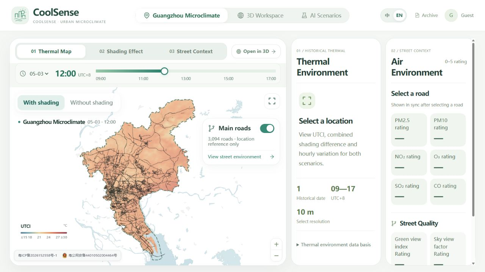
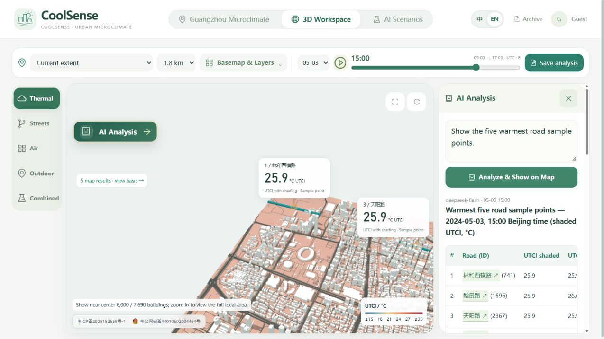

# CoolSense

### AI-assisted urban heat adaptation for more informed outdoor decisions

CoolSense is a prototype that helps people explore urban heat conditions and compare outdoor locations, times and walking routes in Guangzhou. It brings historical modelled thermal data, spatial analysis and an AI assistant into an interactive mapping experience.

**[Explore the live demo](https://geohealthmap.site/CoolSense/)** · The demo uses historical data and is intended for exploration, not real-time warnings.

## The problem

Urban heat is uneven across places and times. Community activity organisers and outdoor space managers need accessible information to compare options, but interpreting detailed climate and spatial data can be difficult. CoolSense explores how a map and a conversational interface can make these comparisons easier to investigate.

## What the prototype does

- **Explore urban heat:** view hourly Universal Thermal Climate Index (UTCI) estimates and shading scenarios on a map of Guangzhou.
- **Inspect the urban context:** explore streets, buildings and environmental indicators in an interactive 3D workspace.
- **Compare choices:** investigate walking routes and candidate outdoor locations using thermal and other environmental information.
- **Ask questions with AI:** use natural language to request supported spatial queries and see the results on the map. The assistant interprets requests and explains results; spatial values are calculated by software and database tools.

*Historical thermal map and street context.*

*3D workspace showing an AI-assisted spatial query.*

## Demo data and limitations

The published demo uses modelled data for **3 May 2024**, with hourly views from 09:00 to 17:00 Beijing time. It is a historical demonstration, not a live forecast or heat alert. UTCI is a thermal-environment indicator, not an individual medical diagnosis. Route access and site availability require independent checks. Model accuracy, user benefits and health outcomes have not yet been validated through a field pilot.

## Technology

The prototype combines Vue 3 and TypeScript, Leaflet and Three.js, a Python API, PostgreSQL/PostGIS and pgRouting, with a DeepSeek-powered assistant using controlled spatial tools.

## Next steps

Focus the experience on a specific community activity planning task; work with potential users to test whether comparisons are understandable and useful; and validate data and suggested routes against appropriate field evidence.

## About this repository

This repository presents the project and selected screenshots. It does not contain the application source, datasets, credentials or deployment files.

